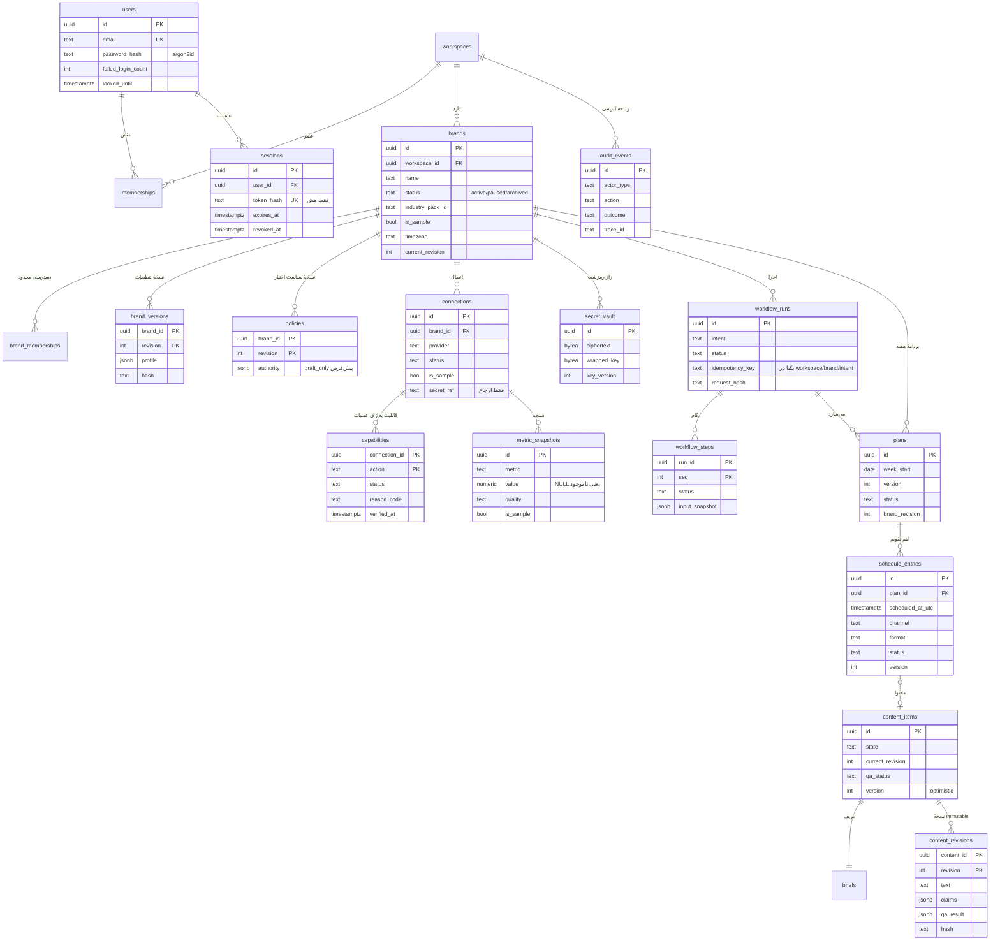
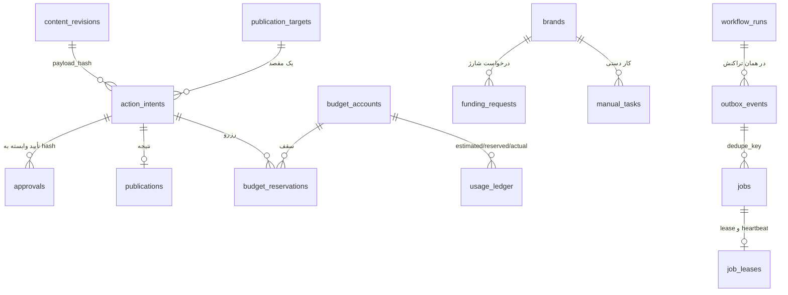

# نمودار موجودیت‌ها (ERD)
منبع: `packages/data/README.md` و migrationهای `packages/data/migrations`. ستون «مرحله» نشان می‌دهد هر جدول در کدام milestone ساخته می‌شود؛ جدول‌های M1 همین حالا در `0001_core.sql` وجود دارند.

## قواعد مشترک
- همهٔ رکوردهای کسب‌وکار `workspace_id` و `brand_id` دارند. ارجاع فرزند به والد با FK مرکب `(workspace_id, brand_id, …)` است؛ پس ارجاع به دادهٔ برند دیگر در خود پایگاه داده رد می‌شود (خطای `CROSS_BRAND_REFERENCE`).
- جدول‌های کسب‌وکار RLS دارند. نقش برنامه (`studio_app`) مالک جدول‌ها نیست و بدون `app.workspace_id` هیچ ردیفی نمی‌بیند. اگر `app.brand_id` تنظیم شود فقط همان برند دیده و نوشته می‌شود.
- نقش migration (`studio_migrator`) جداست. جدول‌های immutable (نسخهٔ برند، نسخهٔ محتوا، سیاست، audit) trigger ضدتغییر دارند و نقش برنامه روی آن‌ها UPDATE/DELETE ندارد.
- شناسه‌ها UUID نسخهٔ ۷ (`uuidv7()` در PostgreSQL 18). زمان‌ها `timestamptz` در UTC. پول عدد صحیح واحد خرد با ارز صریح.
- جدول‌های هویت (`users`، `workspaces`، `memberships`، `sessions`) دادهٔ کسب‌وکار ندارند و RLS روی آن‌ها نیست؛ دسترسی به آن‌ها فقط از سرویس احراز هویت است.

## هسته (M1 — پیاده‌شده)

## اجرای کنترل‌شده و هزینه (M2)

## دانش، دارایی، گفتگو، سئو و گزارش (M3 تا M7)
| گروه | جدول‌ها | مرحله |
|---|---|---|
| دانش برند | knowledge_sources، knowledge_chunks، offers | M3 |
| دارایی | assets، asset_versions | M3 |
| ورودی و کانال مالک | owner_channel_bindings، webhooks_inbox | M4 |
| انتشار | publication_targets، publications | M2، M5 |
| گفتگو و مشتری | conversations، messages، reply_drafts، leads، lead_events، interaction_opportunities | M6 |
| سایت و سئو | seo_audits، seo_findings، site_change_sets | M7 |
| تبلیغات و آزمایش | campaigns، experiments | M7 |
| گزارش | reports (گزارش ذخیره‌شده؛ در M1 گزارش هفتگی لحظه‌ای از metric_snapshots ساخته می‌شود) | M7 |

در M1 «offers» داخل سند نسخه‌دار برند (`brand_versions.profile`) نگهداری می‌شود. جدول مستقل offers همراه catalog و freshness در M3 اضافه می‌شود و migration انتقال داده خواهد داشت.

## قیود کلیدی پیاده‌شده
| قید | محل | هدف |
|---|---|---|
| `UNIQUE (workspace_id, brand_id, intent, idempotency_key)` | workflow_runs | دوبار کلیک یک run می‌سازد |
| `UNIQUE (brand_id, week_start) WHERE status <> 'superseded'` | plans | یک برنامهٔ جاری در هفته |
| `UNIQUE (schedule_entry_id) WHERE state <> 'cancelled'` | content_items | یک محتوا برای هر آیتم تقویم |
| `UNIQUE (brand_id, provider, external_account_id) WHERE status <> 'revoked'` | connections | یک مسیر فعال برای هر حساب |
| `UNIQUE (connection_id, object_id, metric, period_start, period_end)` | metric_snapshots | سنجهٔ تکراری ثبت نشود |
| FK مرکب با پسوند `_scope_fkey` | همهٔ جدول‌های فرزند | رد ارجاع بین برندها |
