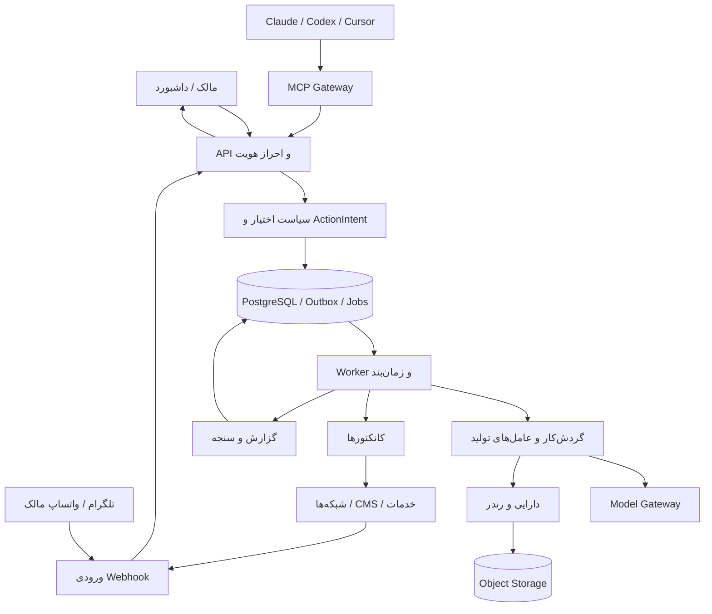

# معماری مرجع
## انتخاب فنی
پیشنهاد طراحی: TypeScript monorepo، pnpm workspace، Next.js برای dashboard، Fastify برای API، PostgreSQL برای داده و صف پایدار مبتنی بر PostgreSQL (مانند pg-boss پس از بررسی نسخه)، object storage سازگار S3 برای رسانه و worker مستقل برای کار طولانی.
FFmpeg برای ویدئو و رندر HTML/SVG برای قالب‌های گرافیکی محلی. این‌ها انتخاب معماری‌اند، نه ادعای بررسی همهٔ نسخه‌ها. سازنده نسخهٔ LTS سازگار و وضعیت مجوز وابستگی‌ها را در M0 تثبیت کند.
هر workspace می‌تواند چند brand پویا داشته باشد؛ جداسازی دانش، اتصال، دارایی، تقویم، گزارش و بودجه از نسخهٔ اول الزامی است.
در نسخهٔ اول Redis، Kubernetes، پایگاه vector جداگانه و میکروسرویس‌های متعدد لازم نیستند. جست‌وجوی اولیه PostgreSQL؛ embedding اختیاری بعد از سنجش نیاز.

## نمودار

## مرزها
apps فقط composition و transport؛ packages/domain منطق کسب‌وکار بدون SDK پلتفرم؛ packages/connectors ترجمه به ارائه‌دهنده؛ workflows ترتیب پایدار؛ agents تولید خروجی ساخت‌یافته بدون حق ارسال مستقیم.
مخزن داده منبع حقیقت است. حافظهٔ چت یا فایل ابزار برنامه‌نویسی منبع وضعیت زمان‌بندی نیست.
هر فرمان از dashboard، MCP یا مالک پیام‌رسان به یک Command و همان PolicyEngine تبدیل می‌شود.
MCP وسیلهٔ کنترل استودیو است؛ ورود به یک ابزار دسکتاپ نباید معادل دسترسی خودکار به حساب‌های استودیو تلقی شود.

## مسیرهای اجرا
local: dashboard/API/worker/DB روی دستگاه؛ در خاموشی هیچ اجرای تضمینی نیست. Telegram polling ممکن؛ webhook عمومی و URL رسانه باید جدا فراهم شوند.
server: همان اجزا در سرور با HTTPS، worker دائمی و backup؛ داشبورد خصوصی و webhookهای محدود عمومی.
harness-assisted: مدل داخل ابزار متصل می‌تواند draft تحویل دهد؛ offline بودن ابزار باعث waiting_for_harness می‌شود. 
server-AI: provider مستقل و بودجه دارد؛ حساب اشتراک چت را معادل مجوز API یا پردازش شبانه فرض نکنید.

## اصول
at-least-once با جلوگیری از side-effect تکراری؛ state machine و نسخهٔ immutable؛ جداسازی workspace؛ بررسی مجوز قبل از اقدام؛ ثبت هزینه؛ توقف فوری کار جدید و بررسی کار درحال ارسال؛ reconciliation برای پاسخ نامعلوم.
