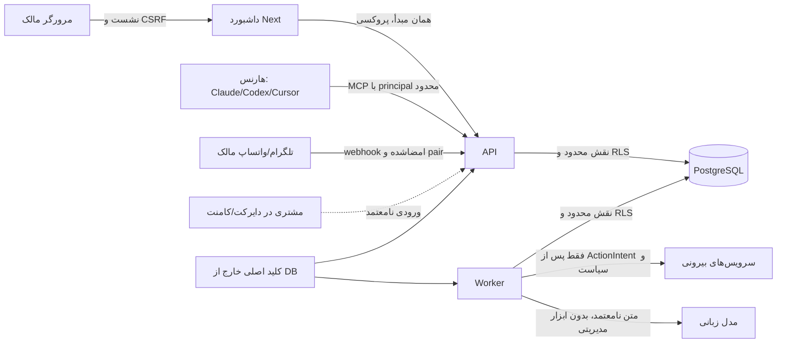

# مدل تهدید
نسخهٔ ۱ | 2026-11-11 | منبع: `packages/security/README.md`، `docs/architecture/README.md` و سناریوهای پذیرش.
ستون «وضعیت» صادقانه است: «پیاده و آزموده» یعنی کنترل در کد وجود دارد و آزمون خودکار دارد؛ بقیه برنامهٔ مرحله‌های بعدند.

## دارایی‌ها
| دارایی | چرا مهم است |
|---|---|
| رازهای اتصال (token، application password، کلید API) | دسترسی مستقیم به حساب‌های مالک |
| کلید اصلی vault | بازکردن همهٔ رازها |
| نشست مالک | کنترل کامل استودیو |
| دانش و دادهٔ هر برند | محرمانگی و جلوگیری از اختلاط برندها |
| اختیار انتشار، پاسخ و هزینه | اقدام خارجی برگشت‌ناپذیر و هزینه‌زا |
| اطلاعات مشتریان در گفتگوها | حریم خصوصی |
| رد حسابرسی | اثبات اینکه چه کسی چه کاری کرد |

## مرزهای اعتماد

هر چیزی که از بیرون می‌آید (صفحهٔ وب، دایرکت، خروجی ابزار، پاسخ مدل) داده است، نه دستور.

## تهدیدها و کنترل‌ها
| # | تهدید | کنترل | محل | آزمون | وضعیت |
|---|---|---|---|---|---|
| T01 | نشت دادهٔ یک برند به برند دیگر (خطای برنامه یا query بدون فیلتر) | RLS با `app.workspace_id` و `app.brand_id`؛ FK مرکب؛ نقش برنامه غیرمالک | packages/data | A07، آزمون isolation | پیاده و آزموده در M1 |
| T02 | دسترسی غیرعضو به workspace یا برند | بررسی عضویت و نقش در سرور پیش از هر query؛ پاسخ 404 یکسان | apps/api | آزمون «درخواست غیرعضو» | پیاده و آزموده در M1 |
| T03 | سرقت یا حدس رمز مالک | argon2id؛ قفل موقت پس از تلاش ناموفق؛ پاسخ با زمان یکسان برای کاربر ناموجود | packages/security، apps/api | آزمون ورود | پیاده و آزموده در M1 |
| T04 | سرقت نشست / CSRF | کوکی HttpOnly + SameSite=Strict (+Secure روی HTTPS)؛ ذخیرهٔ فقط هش نشست؛ نشانهٔ CSRF؛ بررسی Origin | apps/api | آزمون CSRF | پیاده و آزموده در M1 |
| T05 | نشت راز در log، پاسخ API، prompt یا fixture | vault با envelope encryption؛ فقط `secret_ref` در داده؛ حذف راز از log؛ راز پس از ذخیره بازنمایی نمی‌شود | packages/security | آزمون canary | پیاده و آزموده در M1 (log و API)؛ prompt در M3 |
| T06 | سرقت پایگاه داده یا نسخهٔ پشتیبان | کلید اصلی بیرون از DB (STUDIO_HOME یا secret manager)؛ AAD وابسته به برند | packages/security | آزمون vault | پیاده در M1؛ رمزگذاری پشتیبان در M8 |
| T07 | انتشار یا ارسال تکراری (دوبار کلیک، crash، retry کور) | idempotency key؛ ActionIntent پایدار پیش از شبکه؛ lease؛ وضعیت unknown و reconcile | orchestration، worker | A03، A05 | A03 در M1؛ بقیه در M2 |
| T08 | اقدام خارجی بدون اختیار مالک | PolicyEngine در سرور؛ پیش‌فرض draft_only؛ بررسی دوباره درست پیش از dispatch | packages/policy | آزمون سیاست | منطق و آزمون واحد در M1؛ اجرا در مسیر انتشار M2 |
| T09 | ارسال محتوای ویرایش‌شده با تأیید قدیمی | approval وابسته به hash متن، فایل، مقصد، زمان و هزینه | policy، domain | A04 | هش نسخه در M1؛ approval در M2 |
| T10 | هزینهٔ ناخواسته | free_only پیش‌فرض؛ بدون fallback پولی خودکار؛ رزرو اتمیک بودجه؛ FundingRequest | billing، ai | A09، A10، A23 | M2 و M3 |
| T11 | Prompt injection در صفحهٔ وب، دایرکت یا خروجی ابزار | استخراج ساخت‌یافته؛ عامل پاسخ مشتری بدون ابزار مدیریتی؛ اعتبارسنجی schema خروجی | agents، ai | A08 | M3 و M6 |
| T12 | فرمان مدیریتی از طرف مشتری یا غریبه در پیام‌رسان | pair با کد یک‌بارمصرف؛ تفکیک owner و customer؛ دکمهٔ تأیید با TTL | connectors/telegram، policy | A25 | M4 |
| T13 | webhook جعلی یا تکراری | امضای رسمی provider؛ raw-body؛ dedupe با provider_event_id؛ ضد replay | apps/api | A06، A17 | M4 |
| T14 | SSRF از طریق URL سایت یا رسانه | فقط http/https؛ بررسی DNS و IP؛ منع loopback/private/link-local و redirect مجدد؛ allowlist دامنهٔ مالک | packages/security | A17 | M4 |
| T15 | فایل مخرب در upload | محدودیت اندازه؛ MIME واقعی؛ quarantine و scan؛ پاک‌سازی HTML | apps/api، media | A17 | M3 |
| T16 | سوءاستفاده از MCP (shell، SQL، دریافت راز) | فقط ابزارهای مشخص استودیو؛ همان سیاست و audit؛ بدون get_secret | apps/mcp-server | A26 | M6 |
| T17 | failover به provider دوم وقتی نتیجه نامعلوم است | یک active route برای هر حساب؛ unknown مانع failover | connectors | A24 | M5 |
| T18 | وابستگی آلوده (زنجیرهٔ تأمین) | نسخهٔ دقیق و lockfile؛ حداقل سن انتشار ۷ روز؛ منع اسکریپت نصب جز allowlist | pnpm-workspace.yaml | — | پیاده در M0 |
| T19 | افشای ساختار داخلی در خطاها | قالب یکسان خطا بدون stack و SQL؛ trace_id برای پیگیری | apps/api | آزمون خطا | پیاده و آزموده در M1 |
| T20 | دست‌کاری یا حذف رد حسابرسی | جدول append-only با trigger؛ بدون FK cascade به برند | packages/data | آزمون immutable | پیاده و آزموده در M1 |
| T21 | دسترسی شبکه‌ای ناخواسته به سرویس‌ها | در local فقط 127.0.0.1؛ PostgreSQL با scram-sha-256 | infra | — | پیاده در M1؛ سخت‌سازی server در M8 |

## فرض‌ها و ریسک‌های باقی‌مانده
- در پروفایل local امنیت کلید اصلی به حساب کاربری سیستم‌عامل مالک وابسته است؛ بدافزار با دسترسی همان کاربر می‌تواند کلید را بخواند. استفاده از OS secret store در M8 بررسی می‌شود.
- MFA برای owner هنوز پیاده نشده است (برنامه: M8). تا آن زمان داشبورد در local فقط روی 127.0.0.1 گوش می‌دهد.
- محدودیت نرخ ورود درون‌حافظه‌ای است و با restart پاک می‌شود؛ قفل حساب در پایگاه داده پایدار است.
- خروجی مدل زبانی هرگز جایگزین بررسی سرور نیست؛ تا M3 فقط تولید قالبی محلی وجود دارد که ورودی بیرونی نمی‌خواند.
